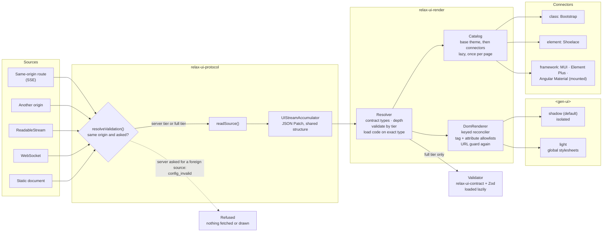

# Browser rendering: any source, any host, any theme library

Feature 003. A document can come from anywhere. The browser decides how much
to trust it, one resolver decides what each node becomes, and a connector
decides what it looks like.

What to read from it:

- **Trust is decided once, per source, before anything is fetched.** Only a
  same-origin URL may skip browser validation, and only on request.
  ([ADR-0011](../adr/0011-same-origin-trust-boundary.md))
- **One resolver for every renderer.** React uses it too, so no host or
  connector can disagree about what a document shows.
  ([ADR-0009](../adr/0009-own-reconciler-on-structural-sharing.md))
- **Output safety sits in the DOM renderer, after the connectors.** Whatever a
  theme or connector returns, text stays text and URLs are checked again.
  Framework components set their own attributes, so their URL props are guarded
  before mount. ([ADR-0012](../adr/0012-mount-contract-for-framework-components.md))
- **The mode is about styles, not trust.** `light` gives up isolation so global
  stylesheets apply; validation and output safety do not change.
  ([ADR-0010](../adr/0010-shadow-and-light-modes.md))
